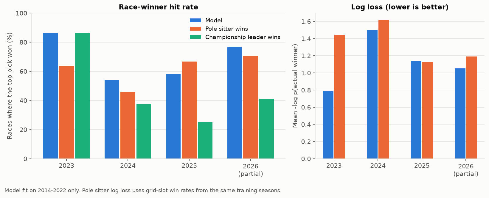
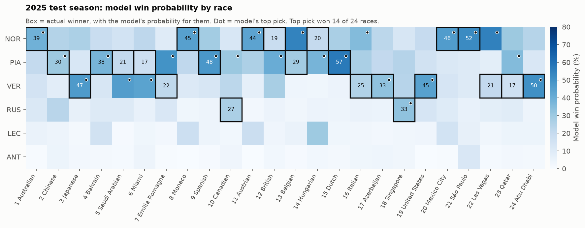
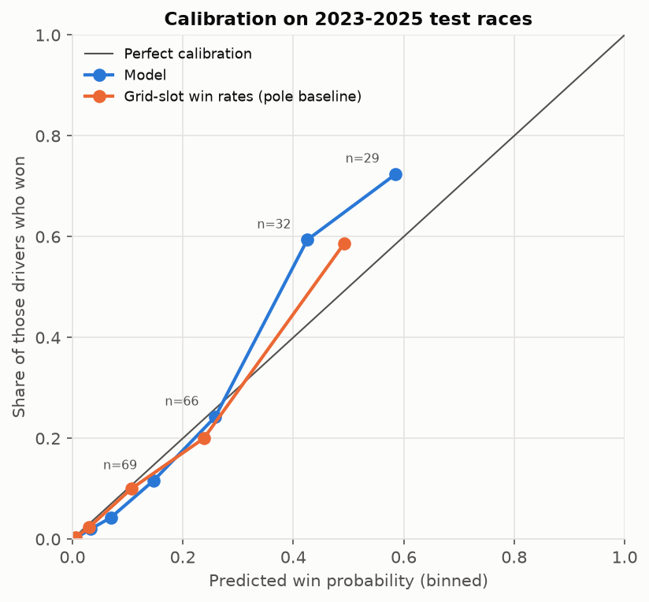

# F1 Race Winner Prediction

This project predicts who will win a Formula 1 Grand Prix using only what is known once the grid is set: the starting order, qualifying, and results of earlier races. It gives every driver a win probability and tests those numbers on three full seasons (2023 to 2025) that the model never saw, next to the simple rule "the pole sitter wins". It is meant for F1 fans and for anyone who wants a worked example of testing a sports model fairly: train on the past, test on later seasons, compare with the obvious baseline.



## Results

The model was fit on 2014 to 2022 and then scored once on every race from 2023 onward. Over the 70 races of 2023 to 2025:

| Method | Winner hit rate | Winner in top 3 | Podium overlap | Log loss | Brier |
|---|---|---|---|---|---|
| Model (random forest) | **65.7%** | **94.3%** | 68.6% | **1.156** | **0.563** |
| Pole sitter wins | 58.6% | 88.6% | 68.6% | 1.395 | 0.615 |
| Championship leader wins | 48.6% | 81.4% | 59.0% | - | - |

By season (winner hit rate, then log loss):

| Season | Races | Model | Pole sitter | Leader | Model log loss | Pole log loss |
|---|---|---|---|---|---|---|
| 2023 | 22 | 86.4% | 63.6% | 86.4% | 0.791 | 1.445 |
| 2024 | 24 | 54.2% | 45.8% | 37.5% | 1.503 | 1.616 |
| 2025 | 24 | 58.3% | 66.7% | 25.0% | 1.143 | 1.127 |
| 2026, rounds 1 to 17 | 17 | 76.5% | 70.6% | 41.2% | 1.054 | 1.191 |

What this says:

- The model beats the pole sitter rule, but only by a little. Over 2023 to 2025 the two picks named different drivers in 18 races: the model was right in 9, the pole pick in 4, neither in 5. A sign test on 9 against 4 gives p = 0.27, so the edge could be luck.
- In 2025 the model did worse than the pole pick. The pole sitter won 16 of 24 races. The model passed over the pole sitter in 4 races, each time for a driver starting second or third with stronger recent form, and was wrong all 4 times.
- In 2023 Max Verstappen won 19 of 22 races, so "pick the championship leader" did as well as the model.
- The probabilities carry more of the gain than the top pick does. Log loss drops from 1.395 to 1.156 (a uniform guess over the field scores 2.99 on these races).
- 2026 brought new technical rules and is only part done. The model has never seen 2026 data, but 17 races is a small sample.

Metric definitions: **winner hit rate** is the share of races where the top pick won. **Winner in top 3** is the share where the winner was among the top three picks. **Podium overlap** is the average share of the actual podium named by the top three picks. **Log loss** is the mean of -ln(probability given to the actual winner). **Brier** is the sum of squared errors over all drivers in a race, averaged over races. The pole sitter row takes its log loss and Brier from grid-slot win rates in the training seasons (pole won 51.6% of 2014 to 2022 races). The leader rule has no probabilities, so it has no log loss.

Why not plain accuracy? About 95% of driver rows are non-winners, so calling every driver a loser scores 95.0% per row on the test seasons and predicts nothing. All numbers here are per race.





The model is roughly calibrated below 35%, but it is too shy about favourites: drivers it gave 35% to 50% won 59.4% of the time (32 cases), and drivers it gave 50% to 70% won 72.4% (29 cases). These bins are small.

The full tables are in [docs/metrics.csv](docs/metrics.csv) and [docs/validation.csv](docs/validation.csv).

## How it works

**Data.** One row per driver per race from 2013 to 2026: grid slot, qualifying position, finishing position, points and status, plus sprint points. 2013 is there only so early 2014 races have form history.

**Features.** Each one is known before the lights go out:

| Feature | What it is |
|---|---|
| `grid_pos` | Starting slot. A pit lane start counts as the back of the grid. For a race not yet run, the qualifying position stands in. |
| `quali_pos` | Qualifying position. |
| `drv_points_share` | Driver's championship points over the leader's, from earlier rounds of the season (race and sprint points). |
| `team_points_share` | The same for constructors. |
| `drv_pts_last5`, `drv_finish_last5`, `drv_grid_last5` | Driver's mean points, finishing position and starting slot over their last 5 races. |
| `drv_wins_last10`, `drv_podiums_last10`, `drv_dnf_rate_last10` | Wins, podiums and share of races not finished over the last 10 races. |
| `team_pts_last5` | Constructor's mean points per race over its last 5 races. |

**Why nothing leaks.**

- Every rolling stat is shifted by one race inside each driver's own history, so a race never sees its own result.
- Team form sums both cars' points per race first and shifts at the race level. Shifting row by row would let one driver's row see the teammate's result from the same race.
- Standings use only earlier rounds. Rebuilt from results and sprints, they match the API's official standings for every driver after 2021 R14, 2023 R5, 2024 R9 and 2025 R23.
- Missing values (rookies with no history) are filled inside the model pipeline, fit on training rows only.
- `tests/test_no_leakage.py` rebuilds each race's features with that race's results blanked and all later races removed, then checks they match the features built from the full data. It runs on synthetic data and on the real data, and it fails if the shift is removed or if team form is computed row by row.

**Model.** Five candidates (two logistic regressions, two histogram gradient boosting models, one random forest) are fit on 2014 to 2021 and compared on 2022 by log loss. The random forest won (1.122 against 1.239 for the next best). That setup is then refit on 2014 to 2022 and scored once on 2023 to 2026. Each driver gets a win score, and scores are scaled so they sum to 1 within each race.

For live use, `model_trainer.py` also refits the same setup on 2014 to 2025 and saves it to `models/model.joblib`. The predictor uses that file. The results above come from the 2014 to 2022 fit only.

## How to run

Python 3.12. From the repo folder:

```bash
python -m venv .venv
source .venv/bin/activate        # Windows: .venv\Scripts\activate
pip install -r requirements.txt

python main_pipeline.py          # fetch data, build features, train, evaluate, draw charts, predict the latest race
python -m pytest                 # leakage tests
```

The first run makes about 140 API calls with a 0.5 second pause between them, so it takes a few minutes. Every page is cached in `data/cache/`, so later runs make no calls. Training takes under a minute on two cores.

Predict a race:

```bash
python predictor.py                              # latest race in the data
python predictor.py --season 2026 --round 17     # any race in the data
python predictor.py --grid RUS,ANT,LEC,HAM,NOR   # a grid you type in, for the next race
python interactive_predictor.py                  # menu: race by round, typed grid, driver stats
python main_pipeline.py --refresh 2026           # download the current season again to pick up new races
```

Each step also runs on its own: `data_collector.py`, `feature_engineering.py`, `model_trainer.py`, `visualizer.py`.

| File | Job |
|---|---|
| `config.py` | Seasons, paths, train/validation/test split |
| `data_collector.py` | Downloads and caches results, qualifying and sprints |
| `feature_engineering.py` | Builds the pre-race features |
| `model_trainer.py` | Picks a model on 2022, scores it on 2023+, writes `docs/metrics.csv` |
| `visualizer.py` | Draws the charts in `docs/` |
| `predictor.py`, `interactive_predictor.py` | Win probabilities for one race |
| `tests/test_no_leakage.py` | Checks features never use the race being predicted |

## Data source and terms

All data comes from the [Jolpica F1 API](https://github.com/jolpica/jolpica-f1) (`https://api.jolpi.ca/ergast/f1/`), the open replacement for the Ergast API. Its [terms](https://github.com/jolpica/jolpica-f1/blob/main/TERMS.md) allow free non-commercial use, and the data is licensed under [CC BY-NC-SA 4.0](https://creativecommons.org/licenses/by-nc-sa/4.0/). The API allows 4 requests per second and 500 per hour; this project stays well under both and caches every reply. The repo holds no raw data. The charts in `docs/` are derived from Jolpica data and share its license.

Data was fetched on 23 October 2026, so 2026 covers rounds 1 to 17. This project is not linked to Formula 1 or the FIA.

## Limits and next steps

- 70 test races is a small sample. One race moves the hit rate by 1.4 points.
- The grid carries most of the signal. The model knows nothing about weather, tyres, safety cars, upgrades or race pace.
- For a race not yet run, qualifying stands in for the grid, so grid penalties are missed.
- Team renames (Force India to Racing Point to Aston Martin, Toro Rosso to AlphaTauri to RB, Renault to Alpine, Sauber to Alfa Romeo to Sauber to Audi) reset team form for a few races.
- In the typed-grid mode, each code maps to the latest driver with that code, who keeps their latest team.
- Next steps: refit before each test season instead of once; try a model that ranks drivers within a race (conditional logit); fix the shyness about favourites with a calibration step fit on a held-out season; add practice pace from FastF1.

This is a learning project. Do not use it for betting.

## Author

Tiiso Letsapa, Letsapamyron07@gmail.com

MIT License for the code. See [LICENSE](LICENSE).
